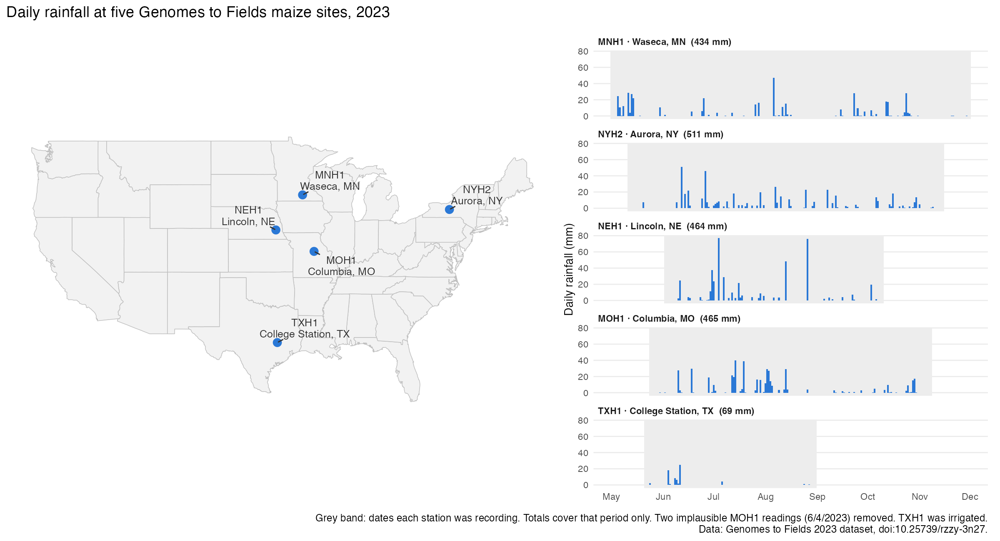
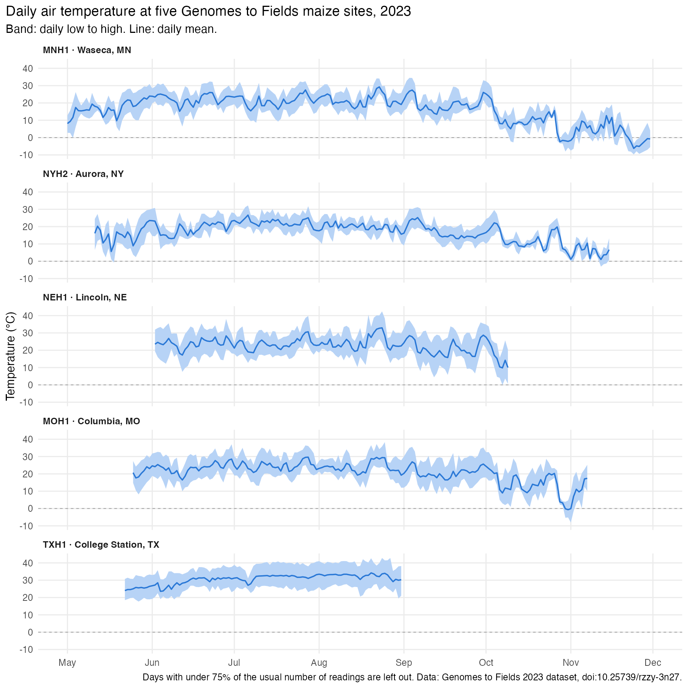

# Weather at five Genomes to Fields maize sites, 2023

2026-11-19

This report summarises in-field weather station data from five maize
trial sites in the [Genomes to Fields 2023
dataset](https://doi.org/10.25739/rzzy-3n27). It is generated from the
scripts in `scripts/`; see the README for how to rebuild it.

## Sites

| Site | City            | State | Irrigated | Planted   | Harvested  |
|:-----|:----------------|:------|:----------|:----------|:-----------|
| TXH1 | College Station | TX    | yes       | 3/1/2023  | 7/26/2023  |
| MOH1 | Columbia        | MO    | no        | 5/24/2023 | 11/7/2023  |
| NEH1 | Lincoln         | NE    | no        | 5/16/2023 | 10/23/2023 |
| MNH1 | Waseca          | MN    | no        | 5/22/2023 | 11/7/2023  |
| NYH2 | Aurora          | NY    | no        | 5/12/2023 | 11/10/2023 |

The stations log at different intervals: every 15 minutes at NEH1, every
30 at MOH1 and TXH1, and every 60 at MNH1 and NYH2. All daily figures
below are built by first summarising readings within each day, so the
different intervals don’t bias the comparison.

## Data cleaning

**Implausible rainfall.** 2 readings reported more than 100 mm in a
single 15–60 minute interval, which is not physically plausible, and
were removed:

| Site | Time           | Rainfall (mm) |
|:-----|:---------------|--------------:|
| MOH1 | 6/4/2023 15:00 |         222.0 |
| MOH1 | 6/4/2023 15:30 |         875.3 |

**Partial days.** For temperature, 7 site-days had fewer than 75% of
that site’s usual number of readings. Their daily low and high would be
misleading, so they were left out (MNH1: 3, MOH1: 2, NEH1: 1, TXH1: 1).

## Rainfall

| Site | First day  | Last day   | Days | Total (mm) | Per day (mm) | Rainy days |
|:-----|:-----------|:-----------|-----:|-----------:|-------------:|-----------:|
| NEH1 | 2023-06-02 | 2023-10-10 |  131 |      463.6 |          3.5 |         44 |
| MOH1 | 2023-05-24 | 2023-11-08 |  169 |      465.3 |          2.8 |         54 |
| NYH2 | 2023-05-11 | 2023-11-15 |  189 |      511.0 |          2.7 |         68 |
| MNH1 | 2023-05-01 | 2023-12-01 |  215 |      433.6 |          2.0 |         56 |
| TXH1 | 2023-05-21 | 2023-08-31 |  103 |       69.1 |          0.7 |         11 |

*Days*: days with any rainfall record. *Rainy days*: days with more than
0.25 mm.

- **NEH1** had the highest average rainfall, 3.5 mm per day over 131
  days of records.
- **TXH1** had the lowest, 0.7 mm per day, with rain on only 11 of 103
  days. TXH1 is also the only irrigated site, so rainfall there
  understates the water the crop received.
- The stations recorded over different periods (shaded grey in the
  figure), so totals and averages are not for a common calendar window.

## Temperature

| Site | Days | Mean (°C) | Highest (°C) | Lowest (°C) | Days ≥ 35 °C | Days ≤ 0 °C |
|:-----|-----:|----------:|-------------:|------------:|-------------:|------------:|
| TXH1 |  102 |      30.5 |         42.8 |        17.7 |           77 |           0 |
| NEH1 |  130 |      22.8 |         42.4 |        -0.1 |           17 |           1 |
| MOH1 |  167 |      20.8 |         38.3 |        -8.1 |           12 |           4 |
| NYH2 |  189 |      16.8 |         32.2 |        -3.1 |            0 |           6 |
| MNH1 |  212 |      16.4 |         34.5 |        -9.7 |            0 |          26 |

- **TXH1** was the warmest site, averaging 30.5 °C, with 77 days
  reaching 35 °C or more.
- **MNH1** was the coolest, averaging 16.4 °C. As with rainfall, sites
  that kept recording into late autumn (and frost) have lower averages
  partly for that reason.

------------------------------------------------------------------------

Data: Genomes to Fields. (2025). *Genomes to Fields 2023 dataset* \[Data
set\]. CyVerse Data Commons. https://doi.org/10.25739/rzzy-3n27
