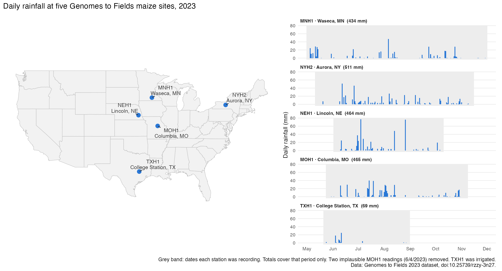
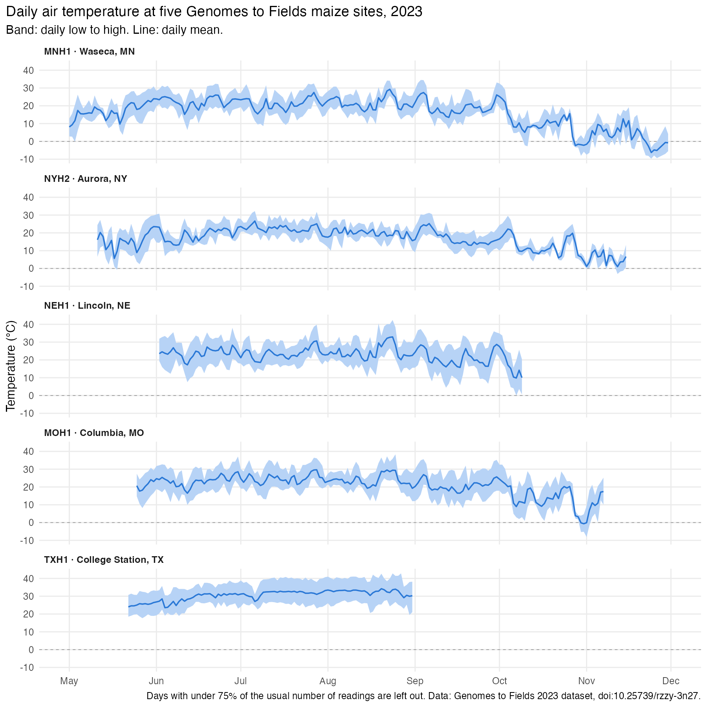

```{r}
# ---- Run the analysis scripts ----

# Each script runs in its own environment, so objects with the same name
# (weather, rain_daily, site_labels) don't overwrite each other. Running them
# also regenerates the figures in figures/.
library(tidyverse)
library(knitr)

rain <- new.env()
source("scripts/average_daily_rainfall.R", local = rain)

rain_map <- new.env()
source("scripts/rainfall_map.R", local = rain_map)

temp <- new.env()
source("scripts/temperature_timeseries.R", local = temp)

sites <- read_csv("data/sites.csv")
```

```{r}
# ---- Numbers used in the text ----

rain_summary <- rain$rain_summary
wettest <- slice_max(rain_summary, mean_mm_per_day)
driest  <- slice_min(rain_summary, mean_mm_per_day)
bad_rain <- rain$weather |> filter(rain_mm > 100)

partial_days <- temp$readings_per_day |> filter(partial_day)

temp_summary <- temp$temp_daily |>
  group_by(site) |>
  summarise(
    days        = n(),
    mean_temp   = mean(temp_mean),
    highest_max = max(temp_max),
    lowest_min  = min(temp_min),
    days_35     = sum(temp_max >= 35),
    frost_days  = sum(temp_min <= 0)
  ) |>
  arrange(desc(mean_temp))

warmest <- slice_max(temp_summary, mean_temp)
coolest <- slice_min(temp_summary, mean_temp)
```

This report summarises in-field weather station data from five maize trial
sites in the [Genomes to Fields 2023 dataset](https://doi.org/10.25739/rzzy-3n27).
It is generated from the scripts in `scripts/`; see the README for how to
rebuild it.

## Sites

```{r}
sites |>
  select(Site = site, City = city, State = state, Irrigated = irrigated,
         Planted = date_planted, Harvested = date_harvested) |>
  kable()
```

The stations log at different intervals: every 15 minutes at NEH1, every 30
at MOH1 and TXH1, and every 60 at MNH1 and NYH2. All daily figures below are
built by first summarising readings within each day, so the different
intervals don't bias the comparison.

## Data cleaning

**Implausible rainfall.** `r nrow(bad_rain)` readings reported more than
100 mm in a single 15–60 minute interval, which is not physically plausible,
and were removed:

```{r}
bad_rain |>
  select(Site = site, Time = Date_key, `Rainfall (mm)` = rain_mm) |>
  mutate(`Rainfall (mm)` = round(`Rainfall (mm)`, 1)) |>
  kable()
```

**Partial days.** For temperature, `r nrow(partial_days)` site-days had fewer
than 75% of that site's usual number of readings. Their daily low and high
would be misleading, so they were left out
(`r partial_days |> count(site) |> mutate(t = str_glue("{site}: {n}")) |> pull(t) |> str_flatten_comma()`).

## Rainfall

```{r}
rain_summary |>
  mutate(across(c(total_mm, mean_mm_per_day), \(x) round(x, 1))) |>
  select(Site = site, `First day` = first_day, `Last day` = last_day,
         Days = days_with_data, `Total (mm)` = total_mm,
         `Per day (mm)` = mean_mm_per_day, `Rainy days` = rainy_days) |>
  kable()
```

*Days*: days with any rainfall record. *Rainy days*: days with more than
0.25 mm.

- **`r wettest$site`** had the highest average rainfall,
  `r round(wettest$mean_mm_per_day, 1)` mm per day over
  `r wettest$days_with_data` days of records.
- **`r driest$site`** had the lowest, `r round(driest$mean_mm_per_day, 1)` mm
  per day, with rain on only `r driest$rainy_days` of
  `r driest$days_with_data` days. TXH1 is also the only irrigated site, so
  rainfall there understates the water the crop received.
- The stations recorded over different periods (shaded grey in the figure), so
  totals and averages are not for a common calendar window.



## Temperature

```{r}
temp_summary |>
  mutate(across(c(mean_temp, highest_max, lowest_min), \(x) round(x, 1))) |>
  select(Site = site, `Days` = days, `Mean (°C)` = mean_temp,
         `Highest (°C)` = highest_max, `Lowest (°C)` = lowest_min,
         `Days ≥ 35 °C` = days_35, `Days ≤ 0 °C` = frost_days) |>
  kable()
```

- **`r warmest$site`** was the warmest site, averaging
  `r round(warmest$mean_temp, 1)` °C, with `r warmest$days_35` days reaching
  35 °C or more.
- **`r coolest$site`** was the coolest, averaging
  `r round(coolest$mean_temp, 1)` °C. As with rainfall, sites that kept
  recording into late autumn (and frost) have lower averages partly for that
  reason.



---

Data: Genomes to Fields. (2025). *Genomes to Fields 2023 dataset* [Data set].
CyVerse Data Commons. https://doi.org/10.25739/rzzy-3n27
